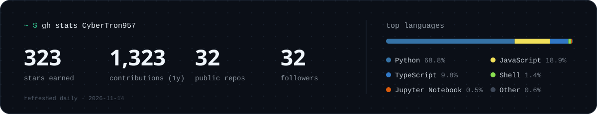

  

  
  
  

I build AI systems that keep working when nobody is watching: multi-agent orchestration, retrieval pipelines, and the backend plumbing that keeps them reliable in production.

- **Founding AI Engineer at BellNexx** (2025–26). Built ExpertAI, a multi-tenant platform for deploying AI employees, on FastAPI, PostgreSQL, Redis and Qdrant, with hybrid retrieval (semantic + BM25 + cross-encoder reranking).
- **B.Tech CSE (AI & ML) at VIT Chennai**, graduating 2027.
- **Right now:** getting AI agents to place real phone calls from an ordinary Android phone and number.
- **Say hi:** [tron0957@gmail.com](mailto:tron0957@gmail.com)

## Featured

### [Agent Teams](https://github.com/CyberTron957/agent-teams) &nbsp;

Self-hosted teams of AI agents that work around the clock. A planner hands work to specialist agents, and the platform keeps them honest: cron and heartbeat scheduling, retry budgets with dead-letter queues, loop detection for stalled conversations, per-team USD budgets that pause spending automatically, and live browser takeover when an agent hits a login or 2FA prompt.

Python · FastAPI · Hermes agent · SQLite · Docker

<table>
<tr>
<td width="33%" valign="top">

**[Viscord](https://github.com/CyberTron957/viscord)** 

Discord-style presence for VS Code. See what your GitHub friends are coding, live. [On the Marketplace](https://marketplace.visualstudio.com/items?itemName=CyberTron957.viscord).

TypeScript · WebSockets · Redis Pub/Sub · GitHub OAuth
</td>
<td width="33%" valign="top">

**[LiteNotes](https://github.com/CyberTron957/LiteNotes)** 

Minimalist notes app with end-to-end encryption, real-time saving, and a customizable interface.

JavaScript · Express · PostgreSQL
</td>
<td width="33%" valign="top">

**[VideoForge](https://github.com/CyberTron957/VideoForge)** 

Turns text into motion-graphics videos. An LLM plans the scenes and deterministic renderers draw them, with no multimodal models.

Python · LangGraph · FastAPI · HTMX
</td>
</tr>
<tr>
<td width="33%" valign="top">

**[WebGPT](https://github.com/CyberTron957/WebGPT)**

AI support chatbot you train on your website and embed with one line, with lead capture, analytics, and knowledge-gap reports.

Python · FastAPI · ChromaDB · Groq / Gemini
</td>
<td width="33%" valign="top">

**[AI Hiring Agency](https://github.com/CyberTron957/AI-Hiring-Agency)**

Resume screening where an LLM judge runs a seeded tournament between candidates and produces an auditable shortlist.

Python · FastAPI · Redis workers
</td>
<td width="33%" valign="top">

**[Zap-Fire](https://github.com/CyberTron957/Zap-Fire)**

Peer-to-peer file transfer in Go, with mDNS peer discovery on your local network.

Go · libp2p
</td>
</tr>
</table>

<b>Everything else I've built</b>

 

| Area | Projects |
|---|---|
| **AI agents & automation** | [Agentic Brand Manager](https://github.com/CyberTron957/Agentic-Brand-Manager) · [Make Your Bot](https://github.com/CyberTron957/Make-your-bot) · [Priority Inbox](https://github.com/CyberTron957/Priority-Inbox) · [chat-2-db](https://github.com/CyberTron957/chat-2-db) · [Voice browser automation](https://github.com/CyberTron957/natural-language-device-automation) · [CodeWizard](https://github.com/CyberTron957/CodeWizard) · [Auto_code](https://github.com/CyberTron957/Auto_code) |
| **Video & content** | [video-to-clips](https://github.com/CyberTron957/video-to-clips) · [YouTube chapters](https://github.com/CyberTron957/youtube-chapters-generator) · [AI blog system](https://github.com/CyberTron957/AI-blog-management-system) · [Cric Sync Studio](https://github.com/CyberTron957/Cric-sync-studio) |
| **Browser extensions** | [ReddHeat](https://github.com/CyberTron957/ReddHeat) · [Prompt Enhancer](https://github.com/CyberTron957/prompt-enhancer) · [SaveDesks](https://github.com/CyberTron957/SaveDesks) · [Junk-fill](https://github.com/CyberTron957/Junk-fill) · [History Summarizer](https://github.com/CyberTron957/history-summarizer) |
| **Networking** | [WebTransport file transfer](https://github.com/CyberTron957/WebTransport-filetransfer) · [Zap-Fire](https://github.com/CyberTron957/Zap-Fire) |
| **Web apps** | [lokkal.news](https://github.com/CyberTron957/lokkal.news) · [weebo](https://github.com/CyberTron957/weebo) · [No-cheat](https://github.com/CyberTron957/No-cheat) · [FFCS timetable builder](https://github.com/CyberTron957/FFCS-optimal-timetable-builder) · [IPL auction game](https://github.com/CyberTron957/IPL-Auction-game) · [Freelance Freedom](https://github.com/CyberTron957/Freelance-Freedom) |

## Stack

  

**AI:** LangGraph · LangChain · AutoGen · CrewAI · MCP · A2A · RAG (hybrid search, reranking) · Qdrant · Claude · Gemini · OpenAI · Groq · Azure AI Foundry

## By the numbers

